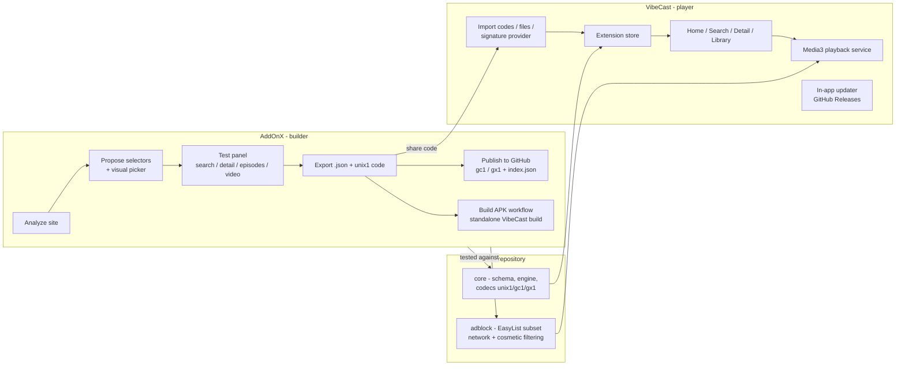

# vibecast

**AddOnX** turns a website link into a declarative extension. **VibeCast** is the
Android streaming app that runs those extensions. Both apps share one engine and one
ad blocker from this repository, so an extension you test inside AddOnX behaves the
same way inside VibeCast.


- Extensions are plain JSON — no executable code, ever.
- Playback is Media3/ExoPlayer in a foreground `MediaSessionService`, with quality
  selection, subtitles, per-stream headers and resume.
- Every WebView and every request on embed pages goes through the same EasyList-based
  ad blocker.
- Releases are signed, reproducible from CI, and both apps update themselves from
  GitHub Releases.



## Install

Grab an APK from
[Releases](https://github.com/tukiza7-debug/vibecast/releases)
(`VibeCast-x.y.z-universal.apk` works on every device; the per-ABI files are smaller).

Before trusting the install, verify the signing certificate matches the fingerprint
published here:

```
Certificate SHA-256:
30 16 8E 58 E5 6B 2D DA 39 8B 2F F4 C9 08 73 3C 6C 90 1E A3 6A 32 D9 4C 84 26 7F D0 C2 C9 81 FD
```

Command line check after downloading:

```bash
apksigner verify --print-certs VibeCast-1.0.0-universal.apk
# Signer #1 certificate SHA-256 digest: 30168e58e56b2dda398b2ff4c908733c6c901ea36a32d94c84267fd0c2c981fd
```

If the digest differs, do not install. Releases are signed with scheme v2 and v3
only; there is no debug-signed fallback build.

## Updating

Both apps check GitHub Releases at most every few hours (conditional requests, no
traffic when unchanged). An update is offered as: short release notes, download for
your ABI (universal fallback), SHA-256 verification against the release's checksums
file, a certificate match against the fingerprint above, then install through
`PackageInstaller` with a progress dialog. You can skip a specific version from the
update dialog. Updates install in place because package ids never change:

- VibeCast: `io.github.tukiza7_debug.vibecast`
- AddOnX: `io.github.tukiza7_debug.addonx`

## Your first extension in five steps (AddOnX)

1. **Install AddOnX** and open it. Paste a website link into the analyzer and let it
   record a listing page.
2. **Review proposals.** AddOnX suggests CSS selectors for title, cover and link with
   confidence levels; it never invents selectors. If nothing reliable is found, use
   the visual picker to tap elements directly in the page.
3. **Walk the steps.** The test panel runs the real engine per step — search, latest,
   detail, episodes, video — and shows raw results; video preview plays through
   Media3 exactly like VibeCast will.
4. **Export.** Save the `.json` file and share the `unix1:…` code, or push the file
   to your own GitHub repository (single file via `gc1:`, or a catalog with
   `index.json` via `gx1:`).
5. **Watch it.** Send the code to VibeCast — deep link, shared text, clipboard or the
   signature-protected direct install — confirm the domains it will contact, and the
   extension appears on Home.

The
[sample extension](sample-extensions/internet-archive.json)
is a complete working example: public-domain films from the Internet Archive's
official JSON API, including pagination, filtering by format and a direct video
strategy.

## Extension format

A full reference with the schema, per-step options and error behaviour lives in
[docs/extension-format.md](docs/extension-format.md). The short version: an extension
names five steps (`search`, `detail`, `episodes`, `video`, plus optional `latest` /
`popular`); each list step is `request` → `source` (HTML selector or JSONPath) →
`fields` (mappings with optional regex/template); the video step resolves a stream via
`direct`, `html`, `regex`, `iframe` or `webviewSniff` and returns URL, MIME, headers,
quality label and subtitle tracks.

```json
{
  "schemaVersion": 1,
  "id": "org.archive.publicdomain",
  "name": "Internet Archive Public Domain",
  "version": 1,
  "lang": "en",
  "baseUrl": "https://archive.org",
  "search": {
    "request": {
      "url": "https://archive.org/advancedsearch.php?q={query}+AND+mediatype%3Amovies&fl%5B%5D=identifier&fl%5B%5D=title&rows=20&page={page}&output=json"
    },
    "source": { "type": "json", "path": "$.response.docs[*]" },
    "fields": {
      "title": { "path": "$.title" },
      "cover": { "path": "$.identifier", "template": "https://archive.org/services/img/{value}" },
      "url": { "path": "$.identifier", "template": "https://archive.org/metadata/{value}" }
    }
  },
  "video": { "request": { "url": "{url}" }, "strategy": "direct", "timeoutMs": 15000 }
}
```

(`detail` and `episodes` steps omitted for brevity; see the sample file for all five.)

## Extension codes

Codes are how extensions travel as text. The full spec — including integrity rules,
size caps and the security model — is in
[docs/extension-codes.md](docs/extension-codes.md).

| Code | Meaning | Example |
|------|---------|---------|
| `unix1:` | whole extension, offline | `unix1:H4sIAAAAAAAA_5yVbW…` |
| `gc1:` | one file in a Git repo, pinned ref | `gc1:example/catalog/extensions/example-movies.json@v1.2.0` |
| `gx1:` | repo with `index.json`, add all or pick, followable | `gx1:example/catalog@main` |

## Ad blocking

`adblock` is used by both apps for every WebView and every HTTP request on iframe and
embed pages. It parses a real subset of the EasyList/ABP syntax — `||domain^` anchors,
separator carets, wildcards, `$third-party`, `$script`, `$image`, `$media`, `$popup`,
and `@@` exceptions — plus cosmetic hiding rules (`##selector`, per-domain). The
matcher is indexed by domain and token (no linear scans, no per-request regex) and
targets sub-millisecond decisions; `MatcherBenchmarkTest` asserts the budget in CI.
Popups and cross-site top navigations without a user gesture are blocked, as are
`intent://`, `market://` and other custom-scheme redirects without a gesture.

Bundled snapshots of EasyList and EasyPrivacy ship in the APK, update at most once a
day via WorkManager with ETag revalidation and validation-before-swap, and fall back
to the bundled copy when a refresh fails. Per-site disable, a blocked counter and
custom rules live in VibeCast Settings. Licenses and attribution:
[LICENSES/filters.md](LICENSES/filters.md). Testing uses MockWebServer fixtures with
fake ad hosts — no real ad networks are contacted by the test suite.

## Repository layout

```
core/     extension schema, validation, execution engine, unix1/gc1/gx1 codecs
adblock/  filter parser, indexed matcher, WebView integration, media sniffer
vibecast/ the streaming app (Compose, Room, Media3, updater)
addonx/   the builder app (analyzer, picker, test panel, exporter, publisher)
sample-extensions/  internet-archive.json, used by tests and CI
docs/     extension-codes.md, extension-format.md
scripts/  compute-version.sh, resolve-extension.py (shared by workflows)
```

## Releases and versioning

`ci.yml` runs on every push and PR: JDK 17, `assembleDebug test lint detekt
ktlintCheck`, plus a live check of the sample extension's endpoints.

`release.yml` runs on pushes to `main`, computes the version per app from Conventional
Commits (`fix` → patch, `feat` → minor, `!`/`BREAKING CHANGE` → major) over commits
that touch that app's path or the shared modules, builds signed universal + per-ABI
APKs, verifies the signing certificate fingerprint against the
`EXPECTED_CERT_SHA256` repository variable, tags (`vibecast-vX.Y.Z` / `addonx-vX.Y.Z`)
and publishes a GitHub Release with APKs and a SHA-256 checksums file. `versionCode`
is `major*1000000 + minor*1000 + patch`; the first release is `1.0.0`. Versions are
never edited by hand.

`build-site-apk.yml` is the workflow AddOnX triggers: give it an extension code or
URL, an app name and a package id, and it produces a standalone signed VibeCast build
with that extension bundled, that name and that package id — same release key, so a
new build with the same id updates in place.

## Building from source

```bash
git clone https://github.com/tukiza7-debug/vibecast
cd vibecast
./gradlew assembleDebug          # debug APKs
./gradlew test lint detekt ktlintCheck
```

Requirements: JDK 17, Android SDK with platform 36. Release builds refuse to run
without signing secrets (see below) — that is deliberate.

## Signing setup

Release signing comes from four repository secrets: `RELEASE_KEYSTORE_B64` (base64 of
the keystore), `RELEASE_KEYSTORE_PASSWORD`, `RELEASE_KEY_ALIAS`,
`RELEASE_KEY_PASSWORD`. The workflow decodes the keystore in-memory, signs with v2+v3
schemes and fails the job if secrets are missing or the fingerprint does not match
`EXPECTED_CERT_SHA256`. The keystore never lives in the repository; keep a backup
outside GitHub, because losing it means losing the update path for every installed
build.

## Troubleshooting

- **An extension's steps pass in AddOnX but fail in VibeCast.** Both apps use the same
  `core` engine; check that you did not edit the JSON between export and import.
- **"Unsupported source" on play.** The stream is DRM-protected or behind an
  anti-bot gate; the apps detect and report this instead of bypassing it.
- **Import says "lower version".** Same id already installed with a higher version;
  either bump `version` in the extension or remove the installed one first.
- **Update check shows nothing.** Checks are throttled to a few hours; pull-to-refresh
  on the Extensions screen forces the check.
- **Site APK does not update in place.** The package id must be identical between
  builds; a different id installs as a separate app by design.

## Known limitations

- End-to-end playback was verified through unit and integration tests, not on a live
  emulator — the build environment has no hardware acceleration for one. The
  emulator update-path check (`adb install -r` across two signed builds) was likewise
  not executed live; the two consecutive signed builds and their fingerprints were
  compared with `apksigner`/`aapt2` instead.
- The ad blocker parses the documented subset of EasyList syntax. Rules outside it
  are skipped, so coverage is below full uBlock-grade filtering by design.
- `webviewSniff` needs a real device session; the desktop test panel reports it as an
  explicit unsupported-strategy error.
- Only one sample extension ships here; publishing catalogs is left to AddOnX users.

## Legal notice

This project ships no media and no catalog of sources. The sample extension targets
the Internet Archive's public, documented APIs for public-domain works. You are
responsible for the extensions you build and use: point them only at sources you have
the right to access. DRM circumvention and anti-bot bypass are out of scope and
rejected by the engine.

## License

The code is Apache-2.0 — see [LICENSE](LICENSE). Bundled filter lists are third-party
data under GPL-3.0; attribution in [LICENSES/filters.md](LICENSES/filters.md).
