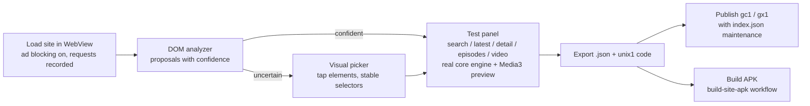

# AddOnX

AddOnX turns a website link into an extension: it records requests while you browse,
proposes selectors, lets you verify every step against the real engine, and ships the
result as JSON, a shareable code, a published GitHub catalog, or a standalone VibeCast
APK. Package id: `io.github.tukiza7_debug.addonx`.




## What it does

- **Analyzer** — loads the target site in the app's WebView (with the shared ad
  blocker), records network requests and DOM structure, then proposes CSS selectors
  for title, cover and link per listing item. Proposals carry confidence levels;
  nothing is invented — when the DOM does not support a stable selector, AddOnX says
  so and offers the picker instead.
- **Visual picker** — tap an element in the live page; `CssSelectorBuilder` turns the
  selection into a stable selector (ids, first class, structural position), with a
  JS bridge (`window.VibePick`) feeding the editor.
- **Step editor** — request URL templates (`{query}`, `{page}`, `{url}`), source kind
  (HTML selector / JSONPath), field mappings with regex and template post-processing,
  per-step headers.
- **Test panel** — runs each step through the same `core` engine VibeCast uses:
  search, latest, detail, episodes, video. Video previews play through Media3 with
  the resolved stream headers; `webviewSniff` is reported as explicitly unsupported
  on the test panel rather than guessed.
- **Export** — one file with the extension JSON, plus a `unix1:` code for direct
  sharing.
- **Publish** — with a GitHub token stored locally, push the extension to your own
  repository: a single file (installable as `gc1:…`) or a catalog with `index.json`
  (installable and followable as `gx1:…`). The publisher maintains the index for you.
- **Build APK** — triggers `build-site-apk.yml` on this repository with an extension
  code/URL, app name and package id; the workflow produces a signed standalone
  VibeCast build with your extension bundled. Same package id keeps updating in
  place.
- **Send to VibeCast** — installs the extension into a same-device VibeCast through
  its signature-protected ContentProvider (snackbar with Undo), or exports a code for
  any of the manual paths.

Tokens and settings are stored locally in the app; nothing is uploaded anywhere
except to the GitHub account you configure.

## Build

```bash
./gradlew :addonx:assembleDebug
./gradlew :addonx:test
```

Release builds need the signing secrets described in the
[root README](../README.md#signing-setup).

## Tests

Unit tests cover the DOM analyzer's proposal logic (including the confidence
thresholds and the never-invent rule) against saved HTML fixtures. The engine,
codecs and filter parser live in `core`/`adblock` with their own suites.
