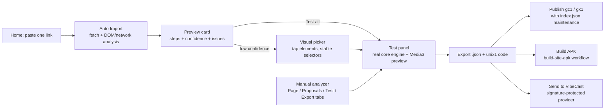

# AddOnX

AddOnX turns a website link into an extension: paste one URL and Auto Import does the
rest, or drive the manual analyzer step by step. Every proposal carries a confidence
level, every step is verified against the real engine, and the result ships as JSON,
a shareable code, a published GitHub catalog, or a standalone VibeCast APK.
Package id: `io.github.tukiza7_debug.addonx`.




## Navigation

Four tabs:

- **Home** — the One-Link Auto Import hero: paste or share a URL, tap *Analyze & Build*,
  and get a ready-to-test extension. Recent links and saved builds appear below.
- **Analyzer** — the manual flow: load a page, review selector proposals, assign
  fields with the visual picker, test steps, export.
- **Builds** — every exported extension with its UNIX code, ready to copy or share.
- **Settings** — appearance, GitHub access, export defaults, ad-block status, local
  data and about.

## One-Link Auto Import

1. Paste a link (or share one from any app — AddOnX registers a share target, and
   `addonx://auto?url=…` deep links work too).
2. AddOnX fetches the page with browser-like headers, reads the DOM and any recorded
   network traffic, detects the page type (listing / detail / JSON API) and proposes
   all four steps with a confidence level each.
3. The preview card shows the proposed name, base URL, per-step confidence, detected
   media candidates and an honest issue list (for example "no search query parameter
   found" or "page looks client-rendered").
4. Actions: **Test all** (opens the analyzer's Test tab with the draft loaded),
   **Edit** (manual analyzer), **Validate & Export** (saved under Builds),
   **Send to VibeCast**, **Copy code**, **Publish** and **Build APK**.

Low-confidence steps never silently guess: they route to the visual picker with
guidance. The analyzer reads only what the page actually contains — no invented
selectors, no invented patterns.

## What the analyzer looks for

- Repeated sibling structures (cards) with title/heading, a real link and an image.
- Pagination (`rel=next`, `?page=` labels) and search query parameters (`q=`, `s=`,
  `search=`, `keyword=`…).
- Video sources in order of reliability: player `file:` directives, `<source>` tags,
  `<video>` tags, bare media links in the HTML, media recorded while browsing,
  and `webviewSniff` as the honest last resort.
- XHR endpoints returning JSON arrays — their keys are mapped to schema fields when
  they clearly match (title/name, url/href, cover/image).

## Visual picker, step editor and test panel

- **Visual picker** — tap an element in the live page; `CssSelectorBuilder` turns the
  selection into a stable selector (ids, first class, structural position), fed back
  over the `window.VibePick` JS bridge.
- **Proposals tab** — ranked proposals with confidence chips, recorded JSON endpoints
  and media URLs, plus your manual field assignments. Client-rendered pages are
  detected and explained instead of failing silently.
- **Test panel** — builds the current draft and runs search → detail → episodes →
  video through the same `core` engine VibeCast uses, with per-step timing and
  errors named by step and field. The video result can be previewed with Media3
  right in the panel.
- **Export** — validation reports every issue at once, exports are saved to Builds,
  and the publish path defaults to your Settings entry.

Tokens and settings are stored locally in the app (GitHub tokens in
EncryptedSharedPreferences); nothing is uploaded anywhere except to the GitHub
account you configure.

## Build

```bash
./gradlew :addonx:assembleDebug
./gradlew :addonx:test
```

Release builds need the signing secrets described in the
[root README](../README.md#signing-setup).

## Tests

Unit tests cover the Auto Analyzer end to end (listing pages, JSON APIs, media
detection, SPA shells, search-template detection) and the DOM analyzer's proposal
logic (confidence thresholds, the never-invent rule) against inline HTML fixtures.
The engine, codecs and filter parser live in `core`/`adblock` with their own suites.
