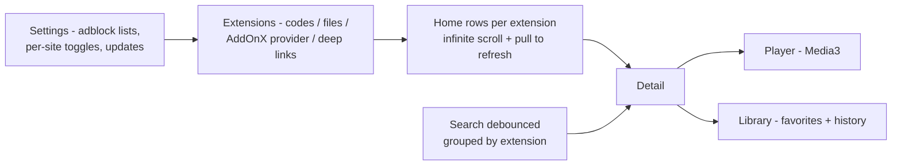

# VibeCast

VibeCast is an Android streaming app that plays media through declarative JSON
extensions built in [AddOnX](../addonx) or shared as codes. Compose Material 3 with
its own visual identity, dark-first. Package id: `io.github.tukiza7_debug.vibecast`.




## What it does

- **Home** — one row per enabled extension, paginated until the source runs out,
  pull-to-refresh everywhere.
- **Search** — debounced input, fan-out to every enabled extension, results grouped
  by source.
- **Detail** — synopsis, episodes, favorite toggle, resume position per item.
- **Library** — favorites and watch history stored in Room, resume from where you
  left off.
- **Extensions** — add by `unix1:` / `gc1:` / `gx1:` code, by JSON file, by deep link
  (`vibecast://add?code=…`), by shared text, by foreground clipboard check, or
  directly from AddOnX through a signature-protected ContentProvider. Every
  non-signature path shows a confirmation sheet: name, id, version, contacted
  domains, code origin. Enable/disable, update, remove; failures are error states,
  never crashes.
- **Player** — Media3 `ExoPlayer` in a `MediaSessionService`, driven through
  `MediaController`; Compose overlay with play/pause, seek bar, speed, seek/brightness/
  volume gestures, next/previous episode, fullscreen landscape, picture-in-picture
  that keeps playing. Quality selection from `TrackSelectionParameters` (with Auto),
  subtitle tracks via `SubtitleConfiguration` with picker and styling. Resume
  position is persisted to Room every few seconds and on pause/stop. Network errors
  retry with backoff; a 403/410/expired URL re-runs the video step once and resumes;
  everything else surfaces a classified error with retry.
- **Updater** — GitHub Releases check with ETag (throttled to a few hours), ABI-matched
  APK download with universal fallback, SHA-256 + signing-certificate verification,
  `PackageInstaller` progress UI, unknown-sources flow, skip-this-version.
- **Standalone builds** — in a `build-site-apk.yml` workflow build, one extension can
  be bundled; the app then opens straight into it (detected via the `site_build`
  resource).

## Ad blocking

The same `adblock` module blocks network requests in every WebView (sniffer and
embed pages), injects cosmetic rules, blocks gesture-less popups and cross-site
navigations, and filters the app's own OkHttp traffic for extension requests.
Settings expose list selection, per-site toggles, a blocked counter and custom rules;
EasyList/EasyPrivacy attribution is in [`LICENSES/filters.md`](../LICENSES/filters.md).

## Build

```bash
./gradlew :vibecast:assembleDebug
./gradlew :vibecast:test
```

Release builds need the signing secrets described in the
[root README](../README.md#signing-setup).

## Tests

Unit tests cover the extension import pipeline (round-trips, downgrades, malformed
indexes, schema rejections), the feed/history repositories, semver comparison used by
the updater, release parsing and the player's MediaItem/quality/recovery logic where
they can run on the JVM. See [Known limitations](../README.md#known-limitations) for
what was not verified on a live emulator.
